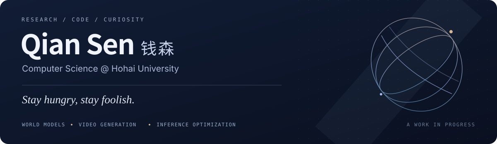

  

  <a href="https://github.com/qiansen0809-droid"><b>English</b></a> · <a href="https://github.com/qiansen0809-droid/qiansen0809-droid/blob/main/README.zh-CN.md">中文</a>
  &nbsp;&nbsp;/&nbsp;&nbsp;
  <a href="#research-focus">Research</a> · <a href="#selected-projects">Projects</a> · <a href="#my-journey">My journey</a> · <a href="#contact">Contact</a>

## About me

Hi, I'm **Qian Sen (钱森)**, an undergraduate studying Computer Science and Technology at **Hohai University**, and a member of the university's Edge Intelligence Research Group.

My current research focuses on **KV cache optimization for efficient inference in large language models**. At the same time, I am building foundational knowledge in **world models, video generation, and embodied intelligence** to explore potential research directions for future master's or doctoral study.

I like turning concrete questions into code and experiments.

**Research interests:** World models · Video generation · Inference optimization

| **3 / 210** | **1st** |
| :---: | :---: |
| Cumulative GPA rank | first year GPA rank in IoT major |

## Research focus

> **What information should we keep when the cache budget is limited?**

`KV cache compression` &nbsp; `Head-wise allocation` &nbsp; `Efficient inference`

I explore this question through paper reading, reproduction of representative methods, and experimental analysis. My work on allocation strategies and cache reuse is ongoing.

[My handwritten reading notes](https://github.com/qiansen0809-droid/CausalDuel-KV/tree/main/notes/handwritten)

## Selected projects

<table>
<tr>
<td width="50%" valign="top">
<h3>01 / KV Cache Research</h3>

<b>Long-context inference · Cache allocation</b>

Learning, reproduction, and experimental exploration based on LU-KV / kvpress, with a focus on allocating cache resources across attention heads and reusing caches across tasks.

<code>KV Cache</code> <code>PyTorch</code> <code>Long-context inference</code>

<a href="https://github.com/qiansen0809-droid/CausalDuel-KV">Explore the project ↗</a> &nbsp; Research fork · Ongoing

</td>
<td width="50%" valign="top">
<h3>02 / BEV Drone Project</h3>

<b>Drone simulation · Bird’s-eye-view maps</b>

RGB and depth capture in AirSim, geometric projection into bird's-eye-view maps, and exploratory CLIP image/text encoding and semantic matching.

<code>AirSim</code> <code>OpenCV</code> <code>CLIP</code>

<a href="https://github.com/qiansen0809-droid/BEV_Drone_Project">Explore the project ↗</a> &nbsp; Research prototype

</td>
</tr>
<tr>
<td width="50%" valign="top">
<h3>03 / StudentBehavior</h3>

<b>Campus data · Employment-risk prediction</b>

A multi-source campus-data pipeline for feature engineering, employment-risk prediction, model comparison, and ensemble learning, with K-Means clustering for student behavior profiles.

<code>scikit-learn</code> <code>Ensemble learning</code> <code>K-Means</code>

<a href="https://github.com/qiansen0809-droid/StudentBehavior">Explore the project ↗</a> &nbsp; Applied machine learning

</td>
<td width="50%" valign="top">
<h3>04 / EAR Recognition</h3>

<b>Acoustic representations · Identity recognition</b>

Adapting an existing x-vector pipeline to EAR audio, using MFCCs, a TDNN, statistical pooling, and a PLDA backend for identity matching and scoring.

<code>PyTorch</code> <code>x-vector</code> <code>PLDA</code>

<a href="https://github.com/qiansen0809-droid/EAR-Recognition-x-vectors">Explore the project ↗</a> &nbsp; Adaptation of existing work

</td>
</tr>
</table>

These are research activities and projects I participate in. Reproduction, adaptation, and original contributions are distinguished in the respective repositories.

## My journey

My defining qualities are a refusal to give up, resilience, and perseverance.

A major setback in the Gaokao kept me from attending the university I had dreamed of. But I did not give up on myself, and I did not want a single exam to define me. I chose to keep learning and to build myself up, one step at a time.

In my first year at Hohai University, I **ranked 1st** in the Internet of Things Engineering (IoT) program. Drawn by a genuine love of computer science, I transferred to Computer Science and Technology to study what I truly wanted to learn.

During my second year, I took courses normally spread across the first two years, earning a **cumulative GPA rank of 3/210**, with the highest academic standing among students who had transferred into the program. It was not until my third year that I finally finished all the additional courses required by the transfer and had a little room to breathe.

In the summer between my second and third years, my interest in research led me to join the university's Edge Intelligence Research Group. I spent the first week reading surveys and foundational papers, gradually building a basic understanding of large language models. Following my curiosity, I chose **KV cache optimization** as the direction I wanted to explore further.

Over the following month, I read more than sixty papers spanning eviction, merging, quantization, and budget allocation, covering key work in the field since 2024. I studied about ten of these in greater depth. During that month of building foundations, I read from six in the morning until ten at night, devoting almost all my time to learning.

> I may not be a student with an exceptional starting point, but I believe hard work can make up for what I lack, and that steady, honest effort will bear fruit. I hope that, one day, my persistence will help me find my own place in computer science.

## Education & skills

**Hohai University** · Undergraduate in Computer Science and Technology

| Category | Skills |
| :--- | :--- |
| Programming | Python · C++ · Java · Rust · MATLAB · Verilog |
| Frameworks & data | PyTorch · scikit-learn · NumPy · pandas |
| Neural networks | Transformer · TDNN |
| Machine learning | Random forest · LightGBM · XGBoost · K-Means |
| Development | AirSim · OpenCV · FastAPI · Git |

## Contact

I'm exploring my own path in research. Feel free to get in touch!

**GitHub** · [@qiansen0809-droid](https://github.com/qiansen0809-droid)  
**Email** · [seanchian@foxmail.com](mailto:seanchian@foxmail.com)

---

Stay hungry, stay foolish.

